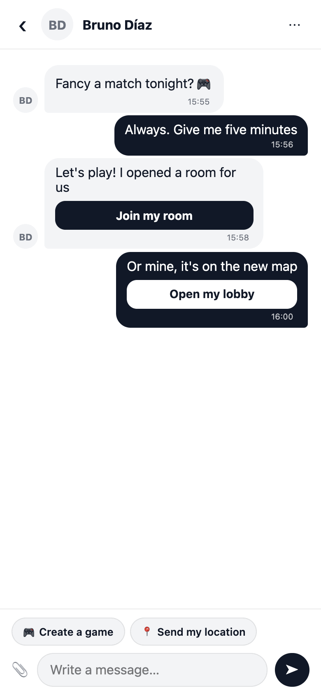
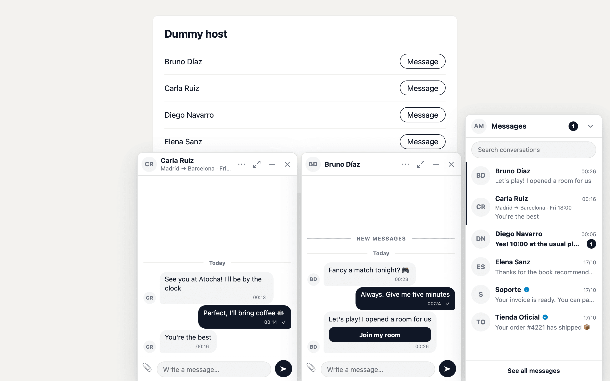
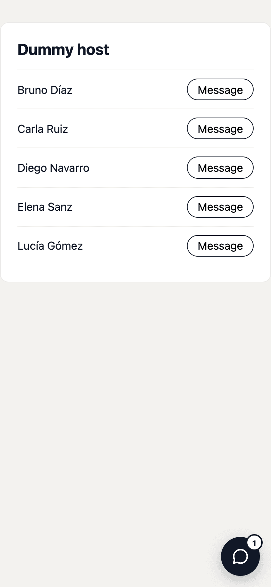
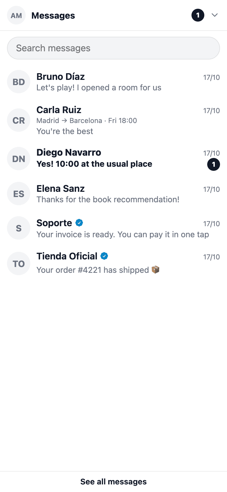
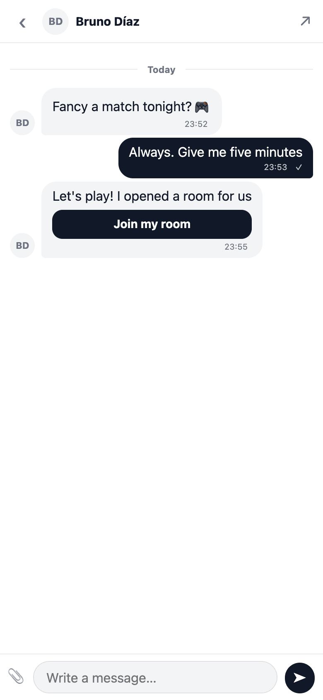

# 💬 `chats` - Add user-to-user DMs & group chats to your Rails app

[](https://badge.fury.io/rb/chats) [](https://github.com/rameerez/chats/actions)

> [!TIP]
> **🚀 Ship your next Rails app 10x faster!** I've built **[RailsFast](https://railsfast.com/?ref=chats)**, a production-ready Rails boilerplate template that comes with everything you need to launch a software business in days, not weeks. Go [check it out](https://railsfast.com/?ref=chats)!

`chats` gives your Rails app **Instagram-class user-to-user messaging**: direct messages, group chats, image attachments, emoji reactions, read receipts, unread badges, and typing indicators — all real-time, all server-rendered.

It's **Hotwire-native**: messages stream live over Turbo Streams + Action Cable, the inbox refreshes itself with Turbo 8 morphing, and the only JavaScript is a few tiny Stimulus controllers the gem ships and registers for you. No SPA, no build step, no custom WebSocket code — and everything degrades gracefully to plain request/response when WebSockets are down. Both the thread and the inbox self-heal after a missed broadcast (cable reconnect / return-to-visible), so a client that slept through a WebSocket drop still catches up.

Every consumer app eventually needs DMs, and everyone rebuilds the same conversation/participant/message schema, the same Action Cable plumbing, and the same "report this message, block this user" story. `chats` is that whole rebuild, done once, done right.

**Contents:** [Example](#-example) · [Quickstart](#quickstart) · [Data model](#-the-data-model) · [The macros](#-the-macros) · [Real-time](#-real-time-the-hotwire-way) · [Trust & Safety](#%EF%B8%8F-trust--safety-snaps-onto-the-moderate-gem) · [Events](#-events-subscribe-to-the-domain-moments) · [Headless messagers](#-headless-messagers-desks-bots-storefronts) · [Official accounts](#-official-accounts-the-verified-badge) · [Grouped inbox](#%EF%B8%8F-grouped-inbox-rows) · [Locked conversations](#-locked-conversations) · [Signed messages](#%EF%B8%8F-signed-messages) · [Action buttons](#-action-buttons) · [View slots](#-view-slots) · [Messaging dock](#-messaging-dock) · [Profile links](#-profile-links) · [Theming](#-make-it-yours) · [Configuration reference](#configuration-reference) · [The full Ruby API](#-the-full-ruby-api) · [View helpers](#-view-helpers) · [Errors](#errors) · [Locales](#locales) · [Upgrading](#upgrading) · [Testing](#testing)

## 👨‍💻 Example

`chats` reads like plain English:

```ruby
class User < ApplicationRecord
  acts_as_messager
end

alice.message!(bob, "hola!")              # DM in one line
alice.chat_with(bob)                       # ...or just open the conversation
alice.chat_with(bob, carol, title: "Trip") # groups
alice.unread_chats_count                   # for your nav badge
```

Conversations can be *about* things in your domain:

```ruby
class Ride < ApplicationRecord
  acts_as_chat_subject
end

passenger.message!(driver, "Can I bring a suitcase?", about: ride)
```

That `about:` gives you marketplace-style threading for free: one conversation per pair *per ride* — and the ride shows up as a context line in the inbox and the thread header.

## Quickstart

Add the gem:

```ruby
gem "chats"
```

Install it (creates the migration + an initializer):

```bash
bundle install
rails generate chats:install
rails db:migrate
```

Make your users conversational and mount the inbox:

```ruby
# app/models/user.rb
class User < ApplicationRecord
  acts_as_messager
end

# config/routes.rb
mount Chats::Engine => "/messages"
```

That's it. `/messages` is now a working, real-time inbox: threads, bubbles, reactions, read receipts, typing indicators. The engine inherits your `ApplicationController` (so your auth, layout, and locale apply automatically — Devise works out of the box), and its bundled Stimulus controllers register themselves through your existing importmap setup. Zero JavaScript changes.

An inbox lists the conversations that have **at least one message** (a system message or a deleted one counts). Opening a conversation (`chat_with`, the Message button) creates it, but until a first message exists it appears nowhere — not in the inbox, its stacks, search, the dock or any count — so nobody's inbox fills with "No messages yet" rows. It still opens when you go to it, which is where the first message gets written.

Drop a "Message" button anywhere — it renders only when the viewer is allowed to message that person:

```erb
<%= chat_button_to @driver, about: @ride %>
```

And a live unread badge in your nav:

```erb
<%= chats_unread_badge %>
```

Or give every page LinkedIn-style floating chat windows with one line in your layout — see [the messaging dock](#-messaging-dock):

```erb
<%= chats_dock %>
```

## What `chats` does (and doesn't) do

**Does:** direct 1:1 threads, group conversations, image (or any) attachments via ActiveStorage, emoji reactions, read receipts ("Seen"), unread counts and live badges, typing indicators, message editing, soft deletion (WhatsApp-style tombstones), system messages your app posts into threads, action buttons under messages ("Pay now", "Join my room"), a LinkedIn-style messaging dock of floating chat windows, per-sender rate limiting, inbox search, infinite scroll-up pagination, optional encryption at rest, and small adapter seams for moderation + notifications.

**Doesn't:** chatbots/LLM agents, workspaces/tenancy, voice/video, public channels, federation. It's peer-to-peer (and group) human messaging — not a Slack clone, not a support-ticketing tool.

> [!NOTE]
> **Want customer support?** Ticketing stays out of `chats` on purpose — queues, assignment and SLAs are not messaging. [`support_desk`](https://github.com/rameerez/support_desk) is the product gem that adds them ON TOP of this one: tickets that are real conversations, a support desk that sends while your staff sign, and a BYOUI agent console. It uses the seams below (headless messagers, subject locks, message authorship, grouped inbox rows), so you get the same threads, attachments and read state you already have.
>
> A product on chats may need a conversation to open although your `inbox_scope` keeps it out of the inbox (a requester's own ticket). `Chats::ApplicationController#conversation_lookup_scopes` is the one extension point for that: every engine endpoint looks a conversation up through it, in order (by default `[viewer.chats]`), and the product appends its own relation, `super + [own_cases_scope]`, from a prepended module. Each scope must hold only conversations the viewer may open: nothing outside them becomes reachable, a miss is still a plain 404, and an error inside a scope is not rescued.

## 🧱 The data model

Five concepts, namespaced and polymorphic from day one (no hard `User` coupling anywhere):

- **`Chats::Conversation`** — `direct` or `group`, optionally *about* a polymorphic `subject` (a ride, an order, a listing). Denormalized `last_message_at` / `last_message_id` / `messages_count` so the inbox is one indexed query.
- **`Chats::Participant`** — a messager's seat in a conversation. Holds role, read horizon, mute, soft-leave, and notification bookkeeping.
- **`Chats::Message`** — `text` (human) or `system` (posted by your app). Soft-deletes to a tombstone. Attachments via ActiveStorage.
- **`Chats::Reaction`** — one row per (message, reactor, emoji); tap-to-toggle, race-safe.
- **Any model with `acts_as_messager`** — users, organizations, support desks, bots: participants and senders are polymorphic. A messager that is not a person declares it (`notifications: false, blockable: false, inbox: :grouped`) and the gem stops treating it like one; an official one (`verified: true`) gets the badge everywhere its name appears. See [`support_desk`](https://github.com/rameerez/support_desk) for the worked example.

Two deliberate design decisions worth knowing:

1. **Read state is a horizon, not per-message receipts.** A participant has ONE `last_read_at`; a message is unread iff it's newer. That's unread counts, badges, and "Seen" indicators with zero extra writes per message (a receipts table writes N rows per message — the classic chat-schema scaling trap), and it's exactly how Basecamp's Campfire models it.
2. **Direct conversations have a deterministic identity** (`direct_key`, unique-indexed): two people DMing each other in the same instant race into the SAME conversation, guaranteed by the database, not by hope.

### Real conversations vs system-only threads

A system message is a message: `post_system_message!` bumps `messages_count`, moves `last_message` and re-sorts the inbox like a human one, and a deleted message stays behind as a tombstone. That is on purpose: "Your ride was cancelled" matters to the passenger, so the inbox lists a thread only your app has spoken in. Two questions, two scopes:

- **`with_messages`** asks *is there anything here?*: any message, system lines and tombstones included. Every list the gem renders reads through it, so a thread that was opened and never used is not listed.
- **`with_human_messages`** asks *did a messager write something here that still stands?*: at least one `text` message that isn't deleted. "Human" is the gem's word for a `text` message: written by a messager, person or not, as opposed to posted by the app. So a bot's or a headless desk's message counts, and so does a photo with no caption. It is for ops walls, moderation lists and "conversations started this week" charts, which must not count a thread holding only "Alice joined".

```ruby
# What a viewer sees: start from alice.chats, so blocks and config.inbox_scope apply
alice.chats.with_human_messages                    # threads where somebody actually wrote
alice.chats.with_messages.without_human_messages   # listed, but only the app has spoken
conversation.last_human_message                    # the newest human message, or nil (a query, not the pointer)
Chats::Message.last_human_in(alice.chats.limit(20))  # the same for a page of threads, in ONE query

# Admin-wide: no viewer, so no blocks and no inbox_scope. Only behind your staff authorization.
Chats::Conversation.with_human_messages.count
Chats::Conversation.about(ride).without_human_messages
Chats::Message.last_human_in(page)                 # page: records, ids, or a relation (read as a subquery, see below)
              .select(:id, :conversation_id, :body)  # narrow the columns if you like
              .index_by(&:conversation_id)         # { id => message }; no key means nobody wrote
```

Both conversation scopes are a single correlated `EXISTS` built from `Chats::Message.human` (kind `text`, not deleted), so they compose with anything (`about`, `unread_by`, `with_messages`) and never multiply rows. `last_human_in` reads an unloaded relation as a subquery without its `includes` (they only load records), so a relation that filters on an associated table needs that table joined explicitly, with `joins` or `left_joins`; `includes(:participants).references(:participants).where(chats_participants: …)` loses the join and raises. Or pass the loaded page, or its ids. Counting what messagers wrote per conversation is the plain `Chats::Message.human.where(conversation_id: ids).group(:conversation_id).count`. None of this changes the inbox, unread counts, `messages_count` or `last_message`.

## 🧩 The macros

### `acts_as_messager(notifications: true, blockable: true, inbox: :default, group_path: nil, verified: false)`

Anyone (or anything) that can hold a seat in a conversation. Every option is a
class-level fact the gem reads duck-typed, so an ordinary model behaves exactly
as before and nothing asks `is_a?(User)`:

| option | default | what it means |
|---|---|---|
| `notifications:` | `true` | `false` for a headless seat: `Participant#notifiable_for?` is never true for it, and `Chats.notifications_for?(messager)` says so |
| `blockable:` | `true` | `false` hides block/report affordances against it and makes `Chats.blockable?(messager)` false |
| `inbox:` | `:default` | `:grouped` folds every direct thread with this messager into ONE inbox row (`Chats::InboxGroup`) |
| `group_path:` | `nil` | `->(viewer) { path }` — where a deep stack opens; default is chats' own filtered inbox |
| `verified:` | `false` | the official-account badge wherever the name renders; refuses to coerce (`"false"` raises at boot) |

Class predicates: `Klass.chat_notifications?`, `.chat_blockable?`, `.chat_inbox_mode`,
`.chat_group_path`, `.chat_verified?`. Instance API below.

### `acts_as_chat_subject`

A domain record conversations can be *about*. Adds `chat_conversations` (`has_many`)
and three overridable readers — the contract a product built on chats (a ticket, an
order) implements:

```ruby
class Ticket < ApplicationRecord
  acts_as_chat_subject

  def chat_subject_label = "Ticket #{reference}"        # the context line in inbox rows and the thread header
  def chat_locked?       = closed?                       # whether the conversation still takes messages
  def chat_locked_notice = "This ticket is closed."      # what replaces the composer when it doesn't
end
```

All three are inert by default (the label falls back to the record's `to_s`, nothing is locked).

## ⚡ Real-time, the Hotwire way

- **The thread** subscribes to one conversation stream. New messages append surgically; edits/deletes replace bubbles in place; the sender's own bubble comes straight back in the form response (no cable round-trip), and Turbo's same-id dedup makes the echo broadcast a no-op.
- **Bubbles are broadcast viewer-agnostic** — one render shared by every subscriber. A tiny Stimulus controller aligns own-vs-other client-side by comparing sender keys. This is what makes single-render broadcasts possible at all.
- **The inbox** receives Turbo 8 page *refreshes* (morphing, scroll-preserving) instead of surgically patched rows: inbox rows are intensely per-viewer (unread badges, bold states, ordering), so each client re-requests and gets a correct, personalized render. Each refresh is tagged so the tab that caused the change skips its own, and carries `method="morph" scroll="preserve"` itself, so it morphs whatever your layout's refresh meta says. A search keeps its query in the URL, so a refresh re-renders the same results, and the field you're typing in is never rewritten under you.
- **Unread badges** get their own stream (`chats_unread_badge` helper) so any page can host a live badge without inheriting inbox refreshes.
- **The messaging dock** has one more per-messager stream (`[messager, :chats_dock]`): its badges, and a signal naming the conversation that changed and whether its window may pop open. The signal only names a conversation the participant can see (blocks and `inbox_scope` applied). No polling, no channel of its own.
- **Typing indicators** are a Turbo Stream *custom action* — ephemeral, nothing persisted, no Action Cable channel class, no connection identification requirements.
- **Cable down?** Everything still works request/response. Real-time is an enhancement, not a requirement.

### What happens when a broadcast is missed

Action Cable has no replay: a broadcast sent while a page's socket is down (a laptop asleep, a phone in a pocket, a backgrounded Hotwire Native WebView, an elevator) never reaches it. So every live surface catches up by itself, with no polling and nothing to configure. It fetches what it missed at the moments it may have missed something, and only then:

- **its stream reconnects.** Every confirmation of the subscription after the first counts, including a socket Action Cable reopened without ever reporting it closed (the half-open TCP of a phone that slept);
- **the page comes back after 10 seconds or more hidden** (an app foregrounded, a tab returned to). A hidden page never fetches; what it missed waits until it is seen;
- **the network comes back online.** Action Cable is asked to check its socket right away instead of waiting out its backoff, and a dead one reconnects (the first trigger);
- **the page is restored**, from the browser's back/forward cache or from Turbo's own snapshot cache (a back navigation, a Hotwire Native stack pop).

Triggers that arrive together make one catch-up, and catch-ups are at least five seconds apart, so a flapping connection can't turn into a fetch loop. While the socket is healthy and the page is on screen, nothing is fetched. What each surface fetches:

| surface | catches up with |
|---|---|
| the inbox | the same morphing page refresh a broadcast triggers. A refresh that arrives while another visit is still loading, which Turbo would otherwise ignore, runs when that visit completes |
| a thread (page or dock window) | `GET /:id/refresh?since=…`: messages created since are appended, edits, tombstones and reactions replaced, the read receipts updated, and, under `deletion: :hard`, bubbles whose messages are gone removed. The composer, its draft and your scroll position are never touched. A thread more than a page behind gets its history re-rendered at the latest page |
| `chats_unread_badge` and the dock's badges | `GET /badge`, every unread badge on the page in one Turbo Stream |
| the dock's recent list | a reload of its frame, morphed in place so it keeps its scroll position and your search |

None of these requests marks anything read, and none can be prefetched (they are not links). On the server, the inbox refresh is enqueued straight into your job queue when the write commits, and not parked first in Turbo's in-process half-second debounce, where a deploy or a crash inside that window would drop it. A burst of messages merges on the client: Turbo runs one page refresh for refreshes that arrive within 150 ms of each other.

**Hotwire Native** needs nothing. The catch-up is the same code path a broadcast takes (the inbox's is a Turbo page refresh, which Turbo hands to the native adapter as it does any refresh), and a back navigation is a Turbo restore, which catches up like any other. A WebView that lives for the whole app session is the case all of this is for: when the app comes back to the foreground, the WebView reports the page visible again, and in any case the socket that died in the background reconnects, and that reconnect is a trigger of its own. **If you wrapped the inbox in a reconciler of your own** (a stream-reconciler controller around `turbo_stream_from … :chats_inbox`), remove it: two reconcilers on one page both fire, and the gem's now covers everything yours did.

## 🛡️ Trust & Safety: snaps onto the [`moderate`](https://github.com/rameerez/moderate) gem

Messages are user-generated content — App Store Guideline 1.2, Google Play's UGC policy, and the EU DSA all expect **report**, **block**, and **filter** capabilities before you ship a chat. Instead of re-implementing any of that, `chats` exposes the exact seams the `moderate` gem expects, with **no hard dependency in either direction**: each gem runs standalone, and together they behave like one system. This section is the complete recipe.

### 1. One line of blocking

```ruby
# config/initializers/chats.rb
Chats.configure do |config|
  config.blocked_messager_ids = ->(user) { Moderate.blocked_ids_for(user) }
end
```

That single hook makes moderate's bidirectional block table the law everywhere chats makes a decision:

- a blocked pair **can't open** a conversation (`Chats::BlockedError`),
- **can't send** into an existing one (a block placed mid-conversation stops the very next message),
- and **stop seeing** each other's direct threads in the inbox and unread counts — *hidden, never deleted*: lift the block and the history reappears.

Two semantics worth knowing: blocking is enforced **beneath** your `can_message` policy (a permissive or buggy policy can never let a blocked pair talk), both are checked on **every direct send**, not only when the thread is opened (a block placed, or a policy turning false, mid-conversation stops the very next message with `:blocked` / `:not_allowed`), and **group conversations are exempt from pair blocks** — the industry standard: blocking someone removes your private line, not your seat in shared spaces. If your domain should eject blocked members from groups, do it in moderate's `on_block` hook by tearing down whatever domain relationship feeds the group membership.

### 2. Reportable + filtered messages

```ruby
# An after-boot hook (config.to_prepare) so the macros re-apply on every reload:
Rails.application.config.to_prepare do
  Chats::Message.has_reportable_content :body, :files
  Chats::Message.moderates :body, mode: :flag    # text → built-in wordlist
  Chats::Message.moderates :files, mode: :flag, with: :your_image_adapter
end

# config/initializers/moderate.rb — the central policy registry:
config.filter "Chats::Message", :body, mode: :flag
config.filter "Chats::Message", :files, mode: :flag, with: :your_image_adapter
```

Use **`:flag`, never `:block`** for chat: you don't gag someone mid-conversation on a wordlist false positive. The message sends; a pending `Moderate::Flag` lands in the moderation queue for human (or ML) review.

`Chats::Message` and `Chats::Conversation` already implement moderate's full duck-typed reportable contract, so everything downstream just works:

| moderate calls… | chats answers… |
|---|---|
| `reported_owner` | the sender (who a decision notifies, who a ban targets) |
| `moderation_snapshot(:body)` | the body — frozen as evidence at report time, surviving later edits/deletes |
| `remove_reported_field!(:body)` | the **soft-delete tombstone** — a moderator's removal looks exactly like a user deletion ("Message deleted"), no special admin rendering path |
| `report_visible_to?(viewer)` | participants only (a DM isn't public content), and never the author |
| `moderation_field_value(:files)` / change detection | attachment-aware seams so image filters classify what actually changed |

### 3. The report affordance — mind the broadcast

Put a report link on every bubble **someone else** sent. One nuance matters: `chats` renders each bubble **once per broadcast, viewer-agnostically** (that's what makes real-time fan-out cheap), so anything depending on `current_user` at render time — like moderate's `report_link` helper, which checks `report_visible_to?(viewer)` — would silently vanish from live-appended bubbles. Use the **signed-target URL** instead (viewer-independent), and hide it on own bubbles with the same client-side mechanism the gem uses for edit/delete:

```erb
<%# in your ejected chats/messages/_message.html.erb, inside .chats-popup__menu
    in the <template data-chats-message-menu> (the long-press menu) %>
<% if message.sender %>
  <%= link_to "Report",
        main_app.new_abuse_report_path(
          target: message.to_sgid_param(for: Moderate::Report::SIGNED_GLOBAL_ID_PURPOSE),
          field: "body"
        ),
        class: "chats-popup__item", role: "menuitem",
        data: { chats_other_only: true } %>
        <%# data-chats-other-only: the popup drops it from your own bubbles;
            moderate's controller re-checks report_visible_to? server-side,
            so hiding is cosmetic %>
<% end %>
```

And give direct threads a **block** action in the thread menu (your ejected `show.html.erb`) pointing at your moderate-backed blocks endpoint. One UX trap: blocking hides the very thread the user is standing in — redirect to the inbox, not back.

### 4. The admin side

Reported and auto-flagged chat messages flow into moderate's standard queues (`Moderate::Report` / `Moderate::Flag` are polymorphic) with **zero chat-specific case statements**: resolving a report with content removal calls `remove_reported_field!` → the tombstone; banning goes through your configured `ban_handler`. For browsing context, point your admin tool at `Chats::Conversation` / `Chats::Message` read-only — and if you want a "flag this while browsing" affordance, file a manual flag and jump to its queue page rather than growing enforcement buttons on the browse surface:

```ruby
Moderate::Flag.flag!(
  flaggable: message, field: "body", owner: message.reported_owner,
  source: "manual", mode: "flag",
  excerpt: message.body.to_s.truncate(500),
  categories: ["manual_review"], scores: {}, context: { flagged_by_admin_id: admin.id }
)
```

### 5. Did you wire it all? The launch checklist

- [ ] `blocked_messager_ids` → `Moderate.blocked_ids_for`
- [ ] `Chats::Message` reportable (`:body`, and `:files` if attachments are on)
- [ ] body + files filter policies in `:flag` mode
- [ ] report link on foreign bubbles (signed target, broadcast-safe)
- [ ] block action on direct threads (redirecting away from the hidden thread)
- [ ] admin queue handles chat flags/reports (it does, automatically — verify with one test)
- [ ] a test that a block placed mid-conversation stops the next send

## 🔔 Events: subscribe to the domain moments

`chats` fires domain moments at subscribers — it does **not** build its own notification bus:

```ruby
# config/initializers/chats.rb (or anywhere that runs at boot)
Chats.on(:message_created)      { |message| NewMessageNotifier.with(record: message).deliver }
Chats.on(:conversation_created) { |conversation| Analytics.track("chat_started", conversation) }
Chats.on(:participant_left)     { |participant| AuditLog.log("chat_left", participant) }
Chats.on(:conversation_read)    { |conversation:, participant:| Bell.mark_read(participant.messager, conversation) }
```

| event | block arguments | when |
|---|---|---|
| `:message_created` | `message` | after a **text** message commits (system messages never notify) |
| `:conversation_created` | `conversation` | once per conversation, never when an existing one is resumed |
| `:participant_left` | `participant` | someone left a group |
| `:conversation_read` | `conversation:, participant:` | a read advanced the horizon past unread content |


Four properties, all of which matter the first time something goes wrong at 3am:

- **Many subscribers per event.** Your mailer, your analytics and your audit log don't have to share one `case` statement.
- **Each one is isolated.** A raising subscriber is reported through `Rails.error.report(e, handled: true, context: { event: })` — *visible*, not swallowed — and the next subscriber still runs. The message is already committed; notifications are best-effort fan-out.
- **Reload-safe.** Registering from reloadable code? Pass a key and a reload replaces the subscriber instead of stacking a second one:

  ```ruby
  Rails.application.config.to_prepare do
    Chats.on(:message_created, key: :unread_email) { |message| … }
  end
  ```
- **Unknown events fail loudly**, at boot, naming the ones that exist.

> **Deprecated:** `config.notifier = ->(event, **payload) {}` still works and will be removed in 1.0. It receives `:message_created` and `:conversation_read` — the two events that existed in 0.1.1 — and *only* those, so an old `->(event, message:, **)` hook can never start raising on an event it was never written for. The events added in 0.2.0 are `Chats.on`-only. Move it to `Chats.on` — that's the whole migration.

The etiquette helpers every messaging product needs ship on the participant, so a debounced "email me only once until I come back" digest is a tiny host job:

```ruby
class ChatsUnreadEmailJob < ApplicationJob
  def perform(message)
    message.conversation.participants.active.each do |participant|
      next unless participant.notifiable_for?(message) # not the sender, not muted, not departed, not headless
      next unless participant.should_notify?           # unread + not already notified this burst

      ChatsMailer.with(participant: participant).unread_messages.deliver_now
      participant.mark_notified!
    end
  end
end

Chats.on(:message_created) { |message| ChatsUnreadEmailJob.set(wait: 10.minutes).perform_later(message) }
```

And it works in the other direction too — your app can post **into** conversations:

```ruby
ride.chat_conversations.find_each { |c| c.post_system_message!("Your ride was cancelled") }
```

## 🤖 Headless messagers: desks, bots, storefronts

Not every messager is a person. A support desk, an order bot or an organization mailbox converses like anyone else but must never be notified, can't meaningfully be blocked, and shouldn't fill the inbox with one row per thread. Say so once, on the model:

```ruby
class SupportDesk < ApplicationRecord
  acts_as_messager notifications: false,   # Participant#notifiable_for? says no, always
                   blockable:     false,   # the views hide block/report affordances
                   inbox:         :grouped # every thread with it is ONE inbox row
end
```

That's the whole point of the option: **your notifiers and views stop asking `is_a?(User)`**. The predicates are on the class (`SupportDesk.chat_notifications?`, `.chat_blockable?`, `.chat_inbox_mode`) and duck-typed everywhere the gem reads them, so an ordinary `acts_as_messager` model behaves exactly as it always did.

## ✅ Official accounts: the verified badge

A support desk, an organization, a shop or a brand is an **official** counterpart, and the person talking to it should see that at a glance — the blue tick everyone already reads. Say it once, on the model, next to the other `acts_as_messager` options:

```ruby
class SupportDesk < ApplicationRecord
  acts_as_messager verified: true
end
```

Every bundled view that shows a messager's name now marks it: the inbox row, the stacked inbox row, and the thread header. The mark is an image with a name, not decoration — `role="img"` plus a localized label (`chats.verified.label`: "Official account" / "Cuenta oficial"), with the glyph itself `aria-hidden` so nothing is announced twice.

`verified:` is **independent of everything else**. A desk is usually headless *and* official; a shop is usually official and completely ordinary otherwise. Combine what you need:

```ruby
acts_as_messager verified: true                                   # official, notifiable, blockable
acts_as_messager notifications: false, inbox: :grouped, verified: true  # an official desk
```

It is the one boolean option that **refuses to coerce**, and that is deliberate — please don't "fix" it into a `!!` to match its neighbours. `notifications:` and `blockable:` coerce, so `notifications: "false"` quietly means `true`; on those two the damage is a stray notification. Here the same slip would hand an account the mark that tells people it is really us, and the strings that reach a model declaration come from exactly the places that produce `"false"`: an ENV var, a YAML round-trip, a settings row. So `verified: "false"` raises `Chats::ConfigurationError` at boot, where somebody is looking, rather than shipping a verified impostor nobody notices.

Read it anywhere you render your own screens — duck-typed, never a class check:

```ruby
SupportDesk.chat_verified?       # the class predicate
Chats.verified?(messager)        # false for a plain model, a nil, a non-messager
chats_verified_badge(messager)   # the view helper: markup, or nil for everyone else
```

**Change the colour** with one CSS variable (the badge inherits it through `currentColor`):

```css
:root { --chats-verified: #0284c7; }
```

The default is `#0284c7` rather than the more familiar `#1d9bf0`. The badge is a meaningful graphic, so it owes 3:1 against what it sits on (WCAG 1.4.11), and `#1d9bf0` is 3.00:1 on the page but **2.73:1 on `--chats-surface`** — the inbox row's hover background, so it failed exactly while someone was pointing at it. `#0284c7` clears the bar on both (4.10 and 3.72) and on a dark ground too (4.33 on `#111827`), so inverting the palette doesn't leave you with a badge you have to remember to fix. If you override it, `test/verified_badge_contrast_test.rb` shows the arithmetic worth repeating.

**Change the glyph** — to your design system's icon, a per-messager mark, or nothing — with a callable that gets the messager and returns html_safe markup (or `nil` for no badge):

```ruby
config.verified_badge = lambda do |messager|
  ApplicationController.helpers.image_tag("official.svg", class: "badge", alt: "Official account")
end
```

Or eject `app/views/chats/shared/_verified_badge.html.erb` with `rails generate chats:views` and rewrite it.

## 🗂️ Grouped inbox rows

With `inbox: :grouped`, every direct conversation a viewer has with that messager folds into a single inbox row — a stack:

```ruby
inbox = Chats::Inbox.for(current_user)   # [Chats::Conversation | Chats::InboxGroup], newest activity first
inbox.unread_count                       # the stack-aware badge number

group = inbox.rows.first
group.messager       # the desk
group.conversations  # the stacked threads, freshest first
group.unread_count   # aggregated across the stack
group.open_count     # how many are in it
```

- `config.inbox_limit` bounds **rows**, not conversations: stacked threads are queried separately from ordinary ones, so a desk with 500 open tickets can never evict your friends from the inbox. A stack's `open_count` and `unread_count` are **global** — two indexed aggregates per stack, however deep it runs — so stacking neither goes N+1 nor loads a stack to count it.
- A stack of one links **straight to the thread**, which then carries a small "see all" link back to the stack.
- The stack list is chats' own filtered inbox — `GET /conversations?with=<signed gid>` — unless you point it somewhere else with `group_path: ->(viewer) { support_path }`.
- Two knobs shape the whole query: `config.inbox_limit` (200) and `config.inbox_scope = ->(relation, viewer) { relation }`.

`user.unread_chats_count` is unchanged (it counts conversations); `Chats::Inbox#unread_count` is the stack-aware number for badges.

## 🔒 Locked conversations

Whether a conversation still takes messages belongs to the thing it's **about** — a closed ticket, a delivered order, an archived listing. The subject already owns the conversation's meaning; it owns its openness too:

```ruby
class Ticket < ApplicationRecord
  acts_as_chat_subject

  def chat_locked?       = closed?
  def chat_locked_notice = "This ticket is closed. Reply to reopen it."
end
```

- `Chats::Message` refuses new messages with an `:locked` error; `Conversation#locked?` and `#locked_notice` read the subject.
- **System messages are exempt**: your app can always post "This ticket was closed" into the thread it just closed.
- The thread **stays readable**. Only the composer changes: it's replaced by the notice (the `locked_composer` slot overrides the body). Gate the action, never hide the explanation.
- A send that lands on a conversation locked since the page loaded gets a **422 that swaps the composer for the notice** — no raise, no lying screen.

Every other write refuses too: `Message#edit!`, `#soft_delete!` and
`Chats::Reaction.toggle!` raise `Chats::LockedError` (a `NotAllowedError`
subclass), the edit/delete/react endpoints answer 422 with the notice, and the
bundled bubble stops offering them. Moderation is the one exception —
`remove_reported_field!` removes reported content from a locked conversation,
because a product lock must never shield it.

## ✍️ Signed messages

`sender` is the seat a message came from; `author` is who **wrote** it on that seat's behalf. That's how a shared desk answers as itself while the human stays visible:

```ruby
desk.message!(alice, "On it!", author: lucia)   # sender: the desk, author: Lucía
message.signed?          # true — author present and not the sender
message.authored_by?(lucia)
```

The bundled bubble renders a signature line ("— Lucía G.") via `Chats.display_name_for`; `config.message_signature = ->(message) { … }` rewrites it. Ordinary messages have no author and render exactly as before.

An author must be persisted, but needs neither `acts_as_messager` nor a conversation
seat. The host authorizes who may send on behalf of a shared identity; the HTTP
message controller never accepts an author from request parameters.

Existing installs get the columns with one command:

```bash
rails generate chats:upgrade && rails db:migrate
```


## 🎯 Action buttons

A support desk writes "Your invoice is ready" and wants a **Pay now** button under it. A game writes "Let's play!" and wants **Join my room**. A marketplace posts "Your ride was cancelled" with **Book another**. Pasting a URL into the body is the wrong answer: one message can carry **one action**, a label and a url, and the bundled bubble renders it as a button.

```ruby
alice.message!(bob, "Let's play!", action: { label: "Join my room", url: play_room_path(room) })
desk.message!(user, "Your invoice is ready", author: lucia, action: { label: "Pay now", url: invoice.payment_url })
conversation.post_system_message!("Your ride was cancelled", action: { label: "Book another", url: new_ride_path })
```



*One action per message: accent-filled under someone else's message, reversed in your own bubble.*

```ruby
message.action          # => #<data Chats::Action label="Join my room", url="/play/abcd">, or nil
message.action?         # => true
message.action.label    # => "Join my room"
message.action.to_h     # => { label: "Join my room", url: "/play/abcd" }

Chats::Action.new(label: "Pay now", url: "/pay")   # accepted anywhere a Hash is
```

`Chats::Action` is an immutable value (`Data`), compared by value. Assign a Hash (string or symbol keys), an Action, or `nil`; anything else raises `ArgumentError` where you assigned it. A key an action doesn't have raises too: `{ label:, url:, method: :post }` would otherwise turn into a plain link without telling you.

**An action is a place to go, not something that happens.** It renders as a link (`data-turbo-frame="_top"`, so it opens the page even from an older page of the thread, which loads inside a frame). It is never a form, and that is on purpose: every bubble is rendered **once** and broadcast to everyone in the thread, and the long-press popup clones it, so nothing that belongs to one viewer can live inside it. A form would need that viewer's CSRF token. If the button should *do* something (accept an offer, pay), point it at a page that asks first and does the work there.

**It is validated when it is written**, so a bad one fails loudly in your code and never renders as a broken or dangerous link:

- `label`: present, at most 80 characters.
- `url`: at most 2048 characters, and EITHER an absolute `http://` / `https://` URL with a host (and, if it names one, a port from 1 to 65535), OR a path on your site that starts with a single `/`. Everything else is refused: `javascript:`, `data:`, `mailto:`, relative paths, and anything a browser would send to another site: `//elsewhere.example`, `///elsewhere.example`, `/\elsewhere.example`, `/<tab>/…`. URLs must be escaped, as Rails' url helpers already produce them.
- The error is `errors.of_kind?(:action, :invalid)`, with a readable message in `en` and `es`.

Body rules don't change: an action goes with a message, it is never a message by itself. Both text and system messages can carry one. `edit!` keeps the action. **A tombstone shows neither the body nor the button**: soft deletion clears the action, and so does a moderator's `remove_reported_field!`, because it goes through the same tombstone. The inbox preview reads “Message deleted”, as for any tombstone.

**Only your Ruby code sets an action.** The composer can't: `Chats::MessagesController` permits `body` and `files` only, the same as with `author:`. Restyle the button with `.chats-message__action` (eject `chats/messages/_action.html.erb` to change its markup). It uses your `--chats-accent` / `--chats-accent-contrast` colours: accent-filled under someone else's message or a system note, reversed inside your own accent-coloured bubble.

### Buttons next to the composer: the `composer_actions` slot

Actions are the buttons your app puts under a message. The `composer_actions` [slot](#-view-slots) is for buttons *you* put next to the composer, such as "Create a game" or "Send my location", without ejecting it:

```erb
<%# app/views/chats/slots/_composer_actions.html.erb %>
<%= button_to "🎮 Create a game", games_path, params: { conversation_id: conversation.id } %>
<%= link_to "📍 Send my location", new_location_path(conversation_id: conversation.id) %>
```

The row appears above the input, **outside** the composer's `<form>`, so `button_to` forms are fine there: a form inside a form is invalid HTML. If the conversation locks, the row goes away together with the composer. Unstyled buttons and links get a small chip look by default. It is applied with zero specificity, so any class you add overrides it.

## ⏱️ One send budget for every composer

`config.send_rate_limit` (60 per minute per sender by default) is enforced by
the gem's own message controller. A product with its **own** composer that
still ends in a chats message — a support form, an order note — shares the
same budget by including one concern, so nobody gets two allowances:

```ruby
class Support::TicketsController < ApplicationController
  include Chats::SendRateLimited
  before_action :enforce_chat_send_rate_limit, only: :create

  private

  def chat_rate_limit_messager = current_user   # whose budget; defaults to the configured current messager
end
```

It counts in the host's cache store (atomic increment, so it works on Rails 7.1
too) and answers `429` with `chats.flashes.rate_limited` when the budget is spent.

## 🔌 View slots

Ejecting a whole screen to add one row or one button is too coarse. The bundled views render a partial named `chats/slots/_<slot>` **when it exists** — no configuration, no registration, and an absent slot costs one memoized lookup:

| slot | where it renders |
|---|---|
| `inbox_top` | above the first inbox row |
| `inbox_empty` | inside the empty state |
| `conversation_header_actions` | the thread's menu (gets `blockable:`) |
| `composer_actions` | a row of your own buttons above the composer's input, outside its form (gets `conversation:`; gone when the thread locks) |
| `locked_composer` | the locked composer's body |
| `message_meta` | after each bubble's timestamp |
| `dock_panel_footer` | beside "See all messages" in the [messaging dock](#-messaging-dock)'s panel (gets `viewer:`) |

```erb
<%# app/views/chats/slots/_inbox_top.html.erb %>
<%= link_to "Need help? Write to us", support_path, class: "support-door" %>
```

An engine mounted on top of chats ships its own `app/views/chats/slots/…`; the host's file wins by view-path order. `rails generate chats:views` is still there for wholesale restyling.

## 🪟 Messaging dock

LinkedIn and Steam don't send you to another page to answer a message: chats live in small windows in the bottom-right corner while you keep doing what you were doing. One line in your layout, for signed-in viewers, gives your app the same:

```erb
<%# app/views/layouts/application.html.erb, before </body> %>
<%= chats_dock %>
```



*Two conversations in floating windows (one with an action button) and the panel of recent conversations. The rows open in a window carry the accent bar.*

- **The bar** sits flush with the bottom-right corner: your avatar, "Messages" and the live unread badge (the same number as `chats_unread_badge`).
- **The panel** opens from it: the inbox's search, your ten most recent conversations exactly as the inbox renders them (stacks, verified badges, a bell-slash on muted ones, previews, unread counts) and "See all messages". It is a `<details>`: it opens without JavaScript, and every row, the search and the link are real links and forms.
- **A window** is the same thread the full page shows (live messages, read receipts, typing, the long-press menu, attachments, action buttons, your `composer_actions`, the locked composer) under a compact header: the name (click it to minimize, as on LinkedIn), the `conversation_header_actions` slot in a ⋯ menu, ⤢ for the full page, – and ×. As many windows open as fit beside the panel, up to three: two at 1280px, one at 768px. Opening one more closes the least recently used window that isn't **in use**. A window in use (it has the focus, or text you haven't sent) is never closed to make room: it folds to a narrow header (its avatar and ×) beside the new window instead. Two limits always hold: never more than `windows:` windows, folded ones included, and never wider than the screen beside the panel. When a conversation can't fit even with every window in use folded, the dock doesn't open it: the row's link opens the conversation's page instead (a pop-up simply doesn't happen). Unfolding a folded window makes room the same way; when it can't, the window stays folded. Narrowing the browser closes idle windows and folds the ones in use, the focused one last; if even a row of folded headers is too wide, the least recently used windows close too, their unsent text kept for when you reopen them. Text in a window that goes away (you close it, it makes room, its conversation becomes unreachable, its load fails) is kept for when you reopen it, and goes back into the composer the moment it appears, unless you've already started typing there.
- **Live**: a new message updates the badge and the list, and opens its conversation's window without taking the focus. That never happens for your own messages, for a conversation you muted, on a phone, for one you closed in the last five minutes, or by closing a window you're using. The window waits with the accent header and its count, and "New message from …" is announced politely. Edits, deletes and your own sends from another tab keep the list in order. A message that arrived while you were offline doesn't pop a window late: the badge and the list [catch up](#what-happens-when-a-broadcast-is-missed), and so does every open window's thread.
- **Reading** waits for you. A minimized window never marks anything read (the thread checks the window's state, not just its size), and a window that popped open marks messages read once you focus it, press in it or scroll it. One you opened yourself reads right away.
- **It stays put**: the dock is `data-turbo-permanent`, so Turbo Drive carries its windows, drafts and scroll positions from page to page. Its id names the viewer, so a visit that lands on another account's page never inherits it. Open windows, minimized ones, recently closed ones, the panel and unsent drafts are kept in `localStorage` under keys that name the viewer (`chats:dock:v1:<key>`, `chats:draft:<key>:<id>`), so a reload brings them back as they were, folded ones included (fitted to the width there is). A browser that refuses storage only means the dock forgets.
- **Keyboard**: Escape unwinds from the inside out (the long-press popup, an edit, the ⋯ menu, then the window minimizes, then the panel closes). Focus rings are inset; the history scrolls with the arrow keys.

On a phone (under 700px wide or 500px tall) the bar becomes a round button with the badge, the panel a full-screen sheet, and a conversation **one full-screen window**, with ← back to the list. While a window is up, the list behind it is out of the tab order; Back returns the focus to it. The sheet holds the focus while it's open (everything around it is made `inert`, siblings of the dock and of each of its ancestors, so a layout that wraps the dock works too), the page behind it doesn't scroll, and the composer sits on the keyboard. This layout is one media query, so it applies before JavaScript runs and without it.

  

**Open a window from your own pages.** `dock: true` on the Message button opens the conversation in the dock instead of navigating to it (a conversation already open in a window is focused, with its draft intact):

```erb
<%= chat_button_to @player, dock: true %>
```

It needs `chats_dock` on the same page: without the dock, the button's response has nowhere to go and nothing happens. Any other link can do the same, or open the panel, with two data helpers. Both stay real links when the dock isn't there:

```erb
<%= link_to "Chat", chats.conversation_path(conversation), data: chats_dock_opener(conversation) %>
<%= link_to "Messages", chats.conversations_path, data: chats_dock_toggle %>
```

**Options:**

```erb
<%= chats_dock windows: 2, recent: 8 %>   <%# at most this many windows (3), conversations in the panel (10) %>
<%= chats_dock launcher: false %>         <%# no round button on phones: your nav opens the sheet (chats_dock_toggle) %>
<%= chats_dock everywhere: true %>        <%# also on the engine's own pages (see below) %>
```

**Not on your messaging pages.** `chats_dock` renders nothing on the engine's own pages (the inbox and the thread already are the messaging UI), and the dock never opens a window for a conversation the page itself shows: the live updates find a thread by its DOM ids, which must exist once. Because the element survives Turbo visits, the server can't remove it from the next page, so the dock also hides itself on any page carrying `data-chats-dock-hide`. The engine's inbox and thread carry it; add it to your own messaging pages. `everywhere: true` renders the dock on the engine's pages too and ignores the attribute.

**Theme it** like the rest of chats. The variables are declared on `.chats-dock`, so re-pointing `--chats-bg` or `--chats-accent` there reaches the dock too:

```css
.chats-dock {
  --chats-dock-z: 40;                 /* above your page, below your modals */
  --chats-dock-offset: 0px;           /* bottom clearance: a cookie banner, a tab bar */
  --chats-dock-inset: 16px;           /* from the right edge */
  --chats-dock-gap: 8px;
  --chats-dock-bar-height: 48px;      /* the bar and every window header */
  --chats-dock-panel-width: 288px;
  --chats-dock-panel-height: 560px;
  --chats-dock-window-width: 336px;
  --chats-dock-window-height: 480px;
  --chats-dock-radius: 12px;
  --chats-dock-hover: #f9fafb;        /* row hover: muted text stays at 4.63:1 */
  --chats-dock-unread-bg: var(--chats-accent);   /* a window waiting to be read */
  --chats-dock-unread-text: var(--chats-accent-contrast);
  --chats-dock-title-font: inherit;
}
```

The `dock_panel_footer` [slot](#-view-slots) puts your own link next to "See all messages". `rails generate chats:views` ejects the dock's partials (`chats/dock/`) along with everything else. All labels are localized under `chats.dock.*`. The window's unread count (`chats.dock.window_unread`) is pluralized in the browser with `Intl.PluralRules` in the page's `<html lang>`: the gem ships `one`/`other`, so add the forms your languages need (`zero`, `two`, `few`, `many`) in your own locale file, e.g. Polish `few: "%{count} nowe wiadomości"`, `many: "%{count} nowych wiadomości"`.

## 🔗 Profile links

`chats` never assumes your app has a `user_path`. Tell it where a messager lives and names become links; leave it alone and they render as plain text:

```ruby
config.messager_url = lambda do |messager|
  routes = Rails.application.routes.url_helpers

  case messager
  when User then routes.user_path(messager)   # a desk or a bot has no profile: nil
  end
end
```

## 🎨 Make it yours

The bundled UI is intentionally framework-free (semantic `chats-*` classes + one self-contained stylesheet, themed with CSS variables):

```css
:root {
  --chats-accent: #facc15;           /* own bubbles, send button, badges */
  --chats-accent-contrast: #111827;
  --chats-verified: #0284c7;         /* the "official account" badge */
}
```

Want full control? Eject the views Devise-style and restyle with your own stack (Tailwind classes added there get picked up by your build, since the files live in your `app/views`):

```bash
rails generate chats:views
```

Override any bundled Stimulus controller by pinning the same importmap key — host pins win. The current keys are `controllers/chats/thread_controller`, `controllers/chats/composer_controller`, `controllers/chats/debounced_submit_controller`, `controllers/chats/refresh_inbox_controller`, `controllers/chats/unread_badge_controller`, and `controllers/chats/dock_controller`. What the inbox, thread, badge and dock controllers share to catch up on missed broadcasts is `chats/recovery` (`recoverMissedBroadcasts`, `renderStreamFrom`); a controller of your own can import it too.

## Configuration reference

Everything lives in `config/initializers/chats.rb` (the install generator writes a fully-annotated version):

```ruby
Chats.configure do |config|
  config.messager_class = "User"

  # Controller integration (Devise-compatible defaults)
  config.parent_controller = "::ApplicationController"
  config.current_messager_method = :current_user
  config.authenticate_method = :authenticate_user!
  config.layout = nil                       # nil inherits the parent controller's

  # Features — all on by default
  config.groups = true
  config.reactions = true
  config.read_receipts = true
  config.typing_indicators = true
  config.editing = true
  config.deletion = :soft                   # :soft (tombstone) | :hard | false
  config.attachments = :images              # false | :images | :any
  config.search = true

  # Limits
  config.messages_per_page = 30
  config.max_message_length = 5_000
  config.max_group_size = 32
  config.max_attachment_size = 10.megabytes
  config.max_attachments_per_message = 4
  config.send_rate_limit = { to: 60, within: 1.minute }  # shared sender budget; nil disables
  config.encrypt_messages = false           # ActiveRecord Encryption on bodies

  # Policies (on top of — never instead of — block enforcement)
  config.can_message = ->(sender, recipient) { true }
  config.can_create_group = ->(creator) { true }

  # Inbox shaping
  config.inbox_limit = 200
  config.inbox_scope = ->(relation, viewer) { relation }

  # Ecosystem seams (no-op defaults; chats runs standalone)
  config.blocked_messager_ids = ->(messager) { [] }
  config.notifier = ->(event, **payload) {}   # DEPRECATED — use Chats.on

  # Display (used by the bundled views)
  config.messager_display_name = ->(messager) { messager.display_name }
  config.messager_avatar = ->(messager) { messager.avatar }  # URL/attachment/variant or nil
  config.messager_url = ->(messager) { nil }                 # nil ⇒ names render as plain text
  config.message_signature = nil                             # ->(message) { } for signed bubbles
  config.verified_badge = nil                                # ->(messager) { markup } for verified: true
end
```

## 🤓 The full Ruby API

```ruby
# Messagers
alice.chat_with(bob)                          # find-or-create the DM
alice.chat_with(bob, about: ride)             # the DM about that ride
alice.chat_with(bob, carol, title: "Trip")    # a group (alice is owner)
alice.message!(bob, "hi", about: ride)        # send (resolves the thread)
alice.message!(conversation, "hi", files: []) # send into a conversation
alice.chats                                   # every conversation she's in (what she may open), newest first
alice.chats.with_messages                     # ...the ones with a message: what lists show
alice.chats.with_human_messages               # ...the ones a messager wrote in (system lines and tombstones don't count)
alice.unread_chats_count                      # conversations with unread messages
alice.message!(bob, "hi", author: lucia)      # written by lucia, sent from alice's seat
alice.message!(bob, "Let's play!",            # with one button under it
               action: { label: "Join my room", url: "/play/abcd" })
Chats::Inbox.for(alice)                       # [Conversation | InboxGroup] + #unread_count
Chats.verified?(desk)                         # official account? (acts_as_messager verified: true)

# Conversations
conversation.participant?(user)               # active membership
conversation.other_participants(user)
conversation.counterpart_for(viewer)          # the other messager (nil for groups)
conversation.title_for(viewer)                # counterpart name / group title
conversation.subject_label                    # "Madrid → Barcelona"
conversation.unread_count_for(user)
conversation.mark_read_by!(user)
conversation.post_system_message!("Ride cancelled")
conversation.post_system_message!("Ride cancelled", action: { label: "Book another", url: "/rides/new" })
conversation.add_participant!(user)           # idempotent, race-safe
conversation.locked?                          # the SUBJECT decides (chat_locked?)
conversation.locked_notice                    # why, in words

# Messages
message.edit!("fixed")                        # stamps edited_at
message.soft_delete!                          # tombstone (or destroy, per config)
message.read_by?(user)
message.signed? / message.authored_by?(lucia) # authorship
message.action / message.action?              # the button: a Chats::Action, or nil
Chats::Action.new(label: "Pay now", url: "/pay")  # .label .url .to_h; Chats::Action.wrap(hash_or_action_or_nil)
Chats::Reaction.toggle!(message:, reactor:, emoji: "👍")

# Participants (the per-member state)
participant.read!                             # advance the read horizon
participant.mute! / participant.unmute!
participant.leave!                            # groups
participant.notifiable_for?(message)          # notification etiquette
participant.should_notify? / participant.mark_notified!
participant.reseat!(new_messager)             # hand the seat over, read horizon intact

# Events
Chats.on(:message_created) { |message| }      # also :conversation_created,
                                              # :participant_left, :conversation_read

# Conversations — finding and creating
Chats::Conversation.direct_between(alice, bob, about: ride)    # nil when none exists
Chats::Conversation.direct_between!(alice, bob, about: ride)   # find-or-create; checks blocks and can_message(alice, bob)
Chats::Conversation.group!(alice, [bob, carol], title: "Trip")
Chats::Conversation.direct .groups .about(ride) .recent_first
Chats::Conversation.inbox_for(alice) .excluding_blocked_for(alice) .unread_by(alice)
Chats::Conversation.with_messages                              # has at least one message, system messages and tombstones included (`last_message_id` set); every list reads through this
Chats::Conversation.with_human_messages .without_human_messages # a messager wrote / only system lines, tombstones or nothing
conversation.last_human_message                                # newest text, non-deleted message, or nil (a query)
Chats::Conversation.unread_counts_for(alice, conversations)    # { id => count } in one query
conversation.direct? / conversation.group?
conversation.participant_for(alice)                            # the seat, or nil
ride.chat_conversations                                        # every conversation about a subject

# Messages — reading
message.system? / message.text? / message.deleted? / message.edited?
message.visible_body                                           # body, or the tombstone text
message.attachments?
message.sent_by?(alice)  message.sender_key
Chats::Message.visible .oldest_first .recent_first .before_message(message)   # keyset pagination
Chats::Message.created_since(time) .updated_since(time)                       # what the stale-thread catch-up reads
Chats::Message.human                                                          # kind text, not deleted: what messagers wrote
Chats::Message.last_human_in(conversations)                                   # newest human message per conversation, one query

# Participants — reading
participant.active? / participant.left? / participant.muted? / participant.owner?
participant.unread? / participant.unread_count / participant.unread_messages
participant.display_name
Chats::Participant.active .muted

# The inbox
inbox = Chats::Inbox.for(alice, query: "trip", with: sgid)   # search, or filtered to one counterpart's stack
Chats::Inbox.for(alice, limit: 10)                           # the first rows only (the dock's recent list)
inbox.rows  inbox.each  inbox.to_a  inbox.size  inbox.any?  inbox.empty?  inbox.filtered?
inbox.conversations                                          # the flat, unstacked list
inbox.unread_counts  inbox.unread_count_for(conversation)  inbox.unread_count
group = inbox.rows.first                                     # a Chats::InboxGroup when the counterpart is inbox: :grouped
group.messager  group.conversations  group.conversation  group.single?
group.unread_count  group.unread?  group.open_count  group.last_message  group.last_message_at
group.title_for(viewer)  group.dom_id  group.with_sgid        # the signed token GET /conversations?with= takes

# Module-level
Chats.display_name_for(messager)  Chats.avatar_for(messager)  Chats.messager_url_for(messager)
Chats.message_signature_for(message)                         # "— Lucía G." or nil
Chats.verified?(m)  Chats.notifications_for?(m)  Chats.blockable?(m)  Chats.grouped_inbox?(m)
Chats.blocked_ids_for(messager)  Chats.blocked_between?(a, b)  Chats.can_message?(sender, recipient)
Chats.inbox_with_sgid(messager)                              # the token behind a stack's "see all"
Chats.messager_key(messager)                                 # "User:42" — what bubbles carry to align own-vs-other
Chats.messager_class?(klass)  Chats.chat_subject_class?(klass)
Chats.on(event, key: nil) { … }  Chats.reset_subscribers!  Chats.reset!  Chats.deprecator
```

Errors are namespaced and meaningful, all under `Chats::Error`:
`Chats::BlockedError` (a blocked pair opening or sending), `Chats::NotAllowedError`
(`can_message` / `can_create_group` said no, groups disabled, a reseat that would
collide) and its subclass `Chats::LockedError` (any non-system write into a
locked conversation), `Chats::ConfigurationError` (boot).

## 🧰 View helpers

All available in the bundled views **and** in your own templates:

| helper | renders |
|---|---|
| `chat_button_to(other, about:, label:, dock:, **html)` | a "Message" button, only when the viewer may message them; `dock: true` opens a dock window instead of navigating |
| `chats_unread_badge(messager = viewer)` | the live unread badge with its own stream; the viewer's own also [catches up](#what-happens-when-a-broadcast-is-missed) on updates it missed |
| `chats_dock(windows: 3, recent: 10, launcher: true, everywhere: false)` | the [messaging dock](#-messaging-dock): bar, panel and floating windows |
| `chats_dock_opener(conversation)` / `chats_dock_toggle` | data for your own links: open that conversation's dock window, or open the dock's panel |
| `chats_muted?(conversation, viewer)` | whether the viewer muted it (read from the preloaded seats) |
| `chats_messager_name(messager, css_class:)` | the name, linked through `messager_url`, badged when verified |
| `chats_messager_avatar(messager)` / `chats_conversation_avatar(conversation, viewer)` | avatar (URL, attachment, variant or initials) |
| `chats_verified_badge(messager)` | the official-account mark, or nil |
| `chats_message_signature(message)` | the "— Lucía G." line for a signed message |
| `chats_preview_for(conversation, viewer)` | the inbox row's last-message preview with its speaker |
| `chats_timestamp(time)` | "12:04" · "Yesterday" · "12 Sep" |
| `chats_slot(name, **locals)` / `chats_slot?(name)` | render a host slot partial when it exists |
| `chats_blockable?(messager)` / `chats_messager_url(messager)` | the duck-typed reads, for your own screens |
| `chats_group_path(group)` / `chats_group_path_for(messager)` | where a stack opens |
| `chats_styles` | the bundled stylesheet tag for your `<head>` |
| `chats_viewer` | the current messager, as the engine resolved it |

## Errors

See the end of [the full Ruby API](#-the-full-ruby-api): `Chats::Error` → `BlockedError`, `NotAllowedError` → `LockedError`, `ConfigurationError`.

## Locales

`en` and `es` ship with the gem under `chats.*` (`inbox`, `thread`, `conversation`, `verified`, `message`, `composer`, `dock`, `buttons`, `flashes`). Your own locale
files **outrank** the gem's — Rails loads every engine's locales first and the
app's last (a 0.2.0 fix; the gem used to re-append its files after yours and
silently win) — so override any key in your `es.yml` and the gem's copy loses.
Bubbles, flashes, the empty inbox, the locked composer and the verified label
(`chats.verified.label`) are all there, and so are the model errors
(`activerecord.errors.models.chats/message.…`, the action's included).


## Upgrading

`chats` ships the migrations a version bump needs; your initializer and views stay yours:

```bash
rails generate chats:upgrade   # 0.2.0: message authorship columns · 0.4.0: the message action column
rails db:migrate
```

0.5.0 needs no migration: the messaging dock is opt-in (`chats_dock`). A few things change on their own: a conversation with no messages is no longer listed (it used to show as a "No messages yet" row), a thread the host's policy no longer allows shows the notice in the composer's place, a Turbo hover prefetch no longer marks a thread read, and the thread body moved into `chats/conversations/_thread.html.erb`. Read the 0.5.0 [CHANGELOG](CHANGELOG.md) entry if you ejected `show.html.erb` or the unread badge. 0.4.0 needs that migration (one nullable JSON column, `chats_messages.action`) and nothing else: actions and the `composer_actions` slot are opt-in. The generator is guarded: it doesn't write the action migration where the column already exists (a fresh 0.4.0 install), and re-running it is harmless. Rolling that migration back keeps the column, because a migration must never drop a column it may not have added. If you ejected the composer, read the 0.4.0 [CHANGELOG](CHANGELOG.md) entry: its DOM changed shape. 0.3.x needs no migration and no new configuration: `verified: true` (0.3.0) and `Chats::SendRateLimited` (0.3.2) are opt-in. Nothing in 0.2.0 changes behaviour until you set an option.

## Database support

PostgreSQL, MySQL, and SQLite. The migration adapts automatically: it honors your app's configured primary key type (**uuid or bigint** — same detection `rails g model` uses), picks `jsonb` on Postgres / `json` elsewhere, and handles MySQL's no-defaults-on-JSON rule. Works on Rails 7.1+ and shines on the Rails 8 omakase.

## Testing

The gem is tested with Minitest against a real dummy host app — models, broadcasts (over the Action Cable test adapter), full request cycles, generators, and every authorization negative (outsiders, leavers, and blocked pairs all get plain 404s; existence never leaks). The Stimulus controllers' decisions run in node, and the dock's layout is measured in a headless Chrome (`test/system`). Under CI (`CI=true`) Chrome is required and its absence fails the run; locally the layout tests skip without it, and the suite prints how many ran.

```bash
bundle exec rake test            # full suite
bundle exec appraisal install    # then test across Rails versions:
bundle exec appraisal rails-7.1 rake test
bundle exec appraisal rails-8.1 rake test
```

## Development

After checking out the repo, run `bundle install`, then `bundle exec rake test`. The dummy app lives in `test/dummy` and mounts the engine at `/messages` exactly like a real host.

## Contributing

Bug reports and pull requests are welcome on GitHub at https://github.com/rameerez/chats. Our code of conduct is: just be nice and make your mom proud of what you do and post online.

## License

The gem is available as open source under the terms of the [MIT License](https://opensource.org/licenses/MIT).
